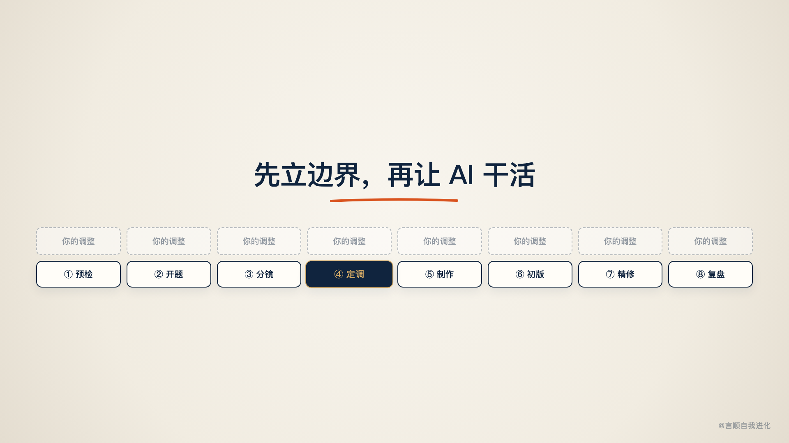

# Editorial Motion Video · 暖纸工程手绘风视频工作流

把「翔宇工作流」的**零 HUD 暖纸暗角 + 聚光灯目录树 + 横向时间轴 + 手绘下划线**质感，全面适配为 **言顺自我进化品牌色（`#10243E` 深蓝 · `#D6AC67` 暖金 · `#D9531E` 琥珀）**，专门用于 16:9 深度视频制作。

## 一、与 `swiss-grid-video` 的区别

| 维度 | `swiss-grid-video` | `editorial-motion-video`（本 Skill） |
| :--- | :--- | :--- |
| **适用场景** | 9:16 竖屏 / 16:9 快节奏工具拆解与核对卡 | 16:9 深度方法论、AI 架构拆解、一人公司实战长片 |
| **背景与 HUD** | 48px 细网格 + 顶部胶囊栏 + 头像声波环 | **暖纸径向暗角 + 零顶部 HUD + 极小右下水印** |
| **核心组件** | 对比卡片、核对清单、放大镜 | **聚光灯目录树、横向时间轴反馈环、大字冲击 + `on air` 画中画** |
| **音频公式** | 真实器乐 `580Hz` 低通 + 每 6–8s 拟音卡点 | 同套实测黄金声学标准 |

## 二、三套内置品牌色视觉组件效果图

| 聚光灯目录树（`?scene=tree`） | 横向时间轴反馈环（`?scene=timeline`） | 大字冲击 + `on air` 画中画（`?scene=punch`） |
| :---: | :---: | :---: |
|  |  |  |

## 三、快速测试内置组件模板

直接用浏览器打开或用 Playwright 渲染 [templates/editorial_kit.html](./templates/editorial_kit.html)，即可预览 4 套内置品牌色组件（支持通过 URL 参数 `?scene=tree|timeline|punch` 切换不同组件效果）。
