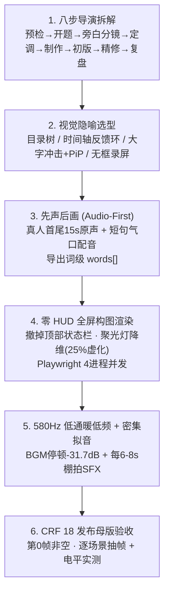

# Editorial Motion Video（暖纸工程手绘风深度视频工作流）

本 Skill 吸收「翔宇工作流 / 阿杜Next」的高级无框短片质感，并全面适配 **言顺自我进化品牌色系**，与 `swiss-grid-video`（卡片网格科普风）形成互补，专门用于 **16:9（1920×1080）30fps** 中长深度讲解视频。



---

## 一、言顺品牌色与暖纸画布规范

| 用途 | 色值 | 说明 |
| :--- | :--- | :--- |
| **暖纸暗角画布** | `#F6F3EC` → `#ECE7DC` | 径向渐变模拟真实纸张暗角，**无硬网格线** |
| **主墨深蓝** | `#10243E` | 大字标题、聚光灯高亮框、大字冲击底块 |
| **品牌暖金** | `#D6AC67` | 冲击词高亮、编号徽章、核心结论点睛 |
| **手绘琥珀朱红** | `#D9531E` | 手绘粗下划线、虚线反馈箭头、关键警告 |
| **降维虚化色** | `rgba(16, 36, 62, 0.24)` | 目录树/时间轴中非当前节点的虚化态 |

---

## 二、4 大核心视觉隐喻组件（拒绝千篇一律白卡片）

内置可直接套用的 HTML/CSS 动效模板见 [templates/editorial_kit.html](./templates/editorial_kit.html)：

1. **`SpotlightTree`（聚光灯目录树）**：
   - 左侧渲染带缩进与图标的真实文件夹层级（`📁 角色 → 总经理 → 📄 岗位手册 / 工作记录`）；
   - **聚光灯降维**：非当前讲解枝干直接降至 `opacity: 0.24`，当前目标节点以 `#10243E` 描边高对比白底卡片突出；右侧大字标题 + 动态手绘 `#D9531E` 粗下划线。
2. **`TimelineLoop`（横向时间轴 + 虚线反馈环）**：
   - 居中手绘下划线大标题 + 横向节点连线（`① 预检 → ② 开题 → … → ⑧ 复盘`）+ 上方虚线框「你的调整 / 人工验收」闭环反馈。
3. **`EditorialPunch`（大字冲击 + 右侧 `on air` 真人画中画）**：
   - 左侧 2/3 超大 `#10243E` 深蓝大字短句块 + 顶部小字免责；右侧 1/3 圆角矩形 `// on air · 言顺` 真人出镜实拍窗（或动态头像）。
4. **`ScreenSpotlight`（无框全屏录屏推拉）**：
   - 撤掉顶部 HUD 与底部大黑条，仅在右下角保留半透明极小 `@言顺自我进化` 水印；字幕使用轻柔无底框阴影白字或极简半透明字幕，不遮挡主构图。

---

## 三、Whisper 语音时间戳校准流程（强制）

所有真人实拍、混剪或配音成片，**严禁凭估算写死时间轴**，必须执行以下校准流程：

1. **提取/校准字级时间戳**：
   ```bash
   yanshun-whisper <音视频文件路径> -o <输出目录>
   ```
   调用本地 Apple Silicon GPU 加速的 `mlx-whisper`（`whisper-large-v3-turbo`，已内置 `condition_on_previous_text=False` 与尾部零时长幻觉过滤），生成 `<base>.whisper.json`（含逐句 `segments[]` 与逐词 `words[]`）和 `<base>.whisper.srt`。
2. **脚本直读驱动渲染**：在 Playwright 渲染脚本（`render_*.mjs`）中直接读取 `<base>.whisper.json` 传入页面 `initEditorial({ frames, segments })`：
   - **字幕全程在线**：无论大口播、全屏冲击字卡还是 PiP 阶段，统一由 `segments[]` 实时驱动，不留无字幕空档；
   - **切场与动作卡点**：每个转场切点、卡片弹出、手绘划线、降维变暗、盖章与棚拍 SFX 均绑定到对应 `segment.start / word.start`，确保“话未说完绝不提前切场”。
3. **关键帧对齐复核**：按转场后/动作触发后 `0.2s–0.5s` 抽帧，用 `read_file` 核对画面与当前字幕文本是否完全对应。

---

## 四、声学与导出硬标准

- **配音建议**：开头 15 秒与结尾 15 秒优先使用真人麦原声实录，中段长讲解可用短句气口分段配音。
- **BGM 配方**：真实器乐底轨挂载 `lowpass=f=580, equalizer=f=110:t=q:w=1.0:g=4.0`，停顿间隙稳在 **`-31 dB ~ -32 dB`**（与人声差 `12–14 dB`），说话时轻侧链闪避（`ratio=2.2`）。
- **密集动效拟音**：每 **6–8 秒** 匹配 1 个棚拍音效（`whoosh-short` / `pop` / `click-soft` / `typing` / `impact-bass-1`）。
- **母版导出**：`libx264 -crf 18 -pix_fmt yuv420p -c:a aac -b:a 192k -movflags +faststart`，限幅 `alimiter=0.85`。
