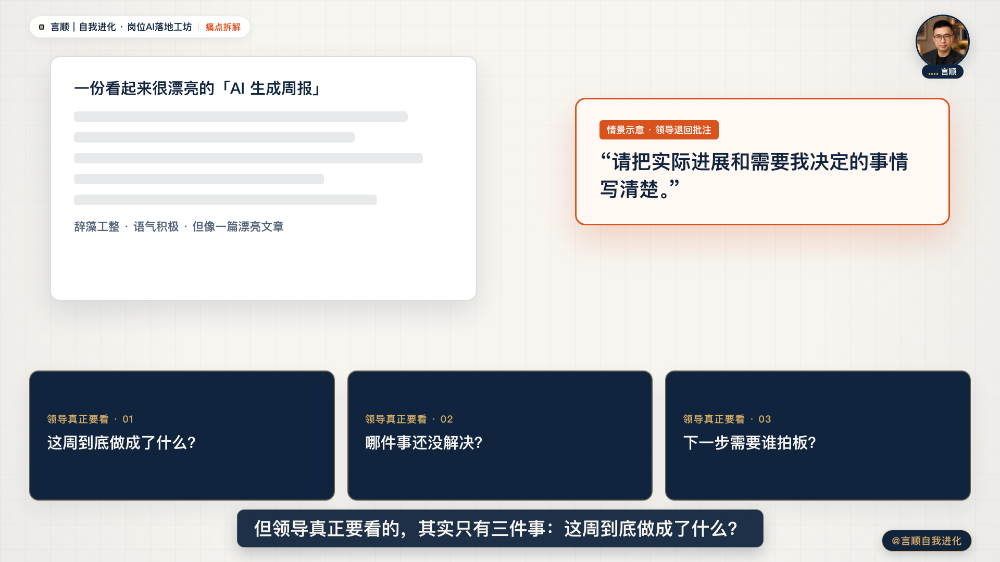
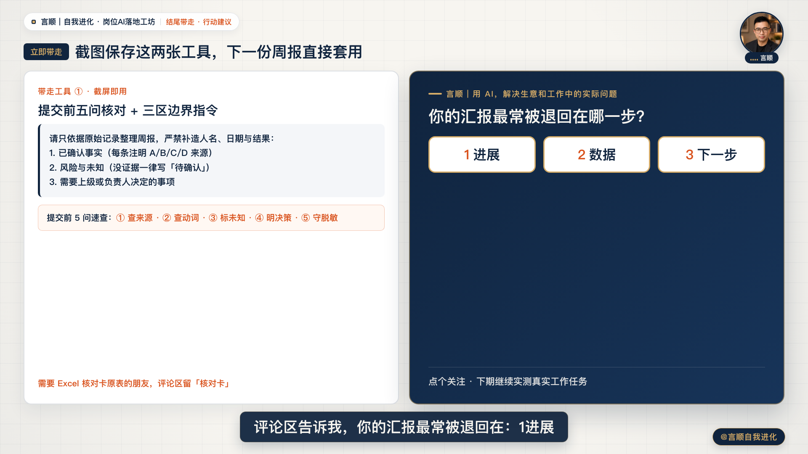
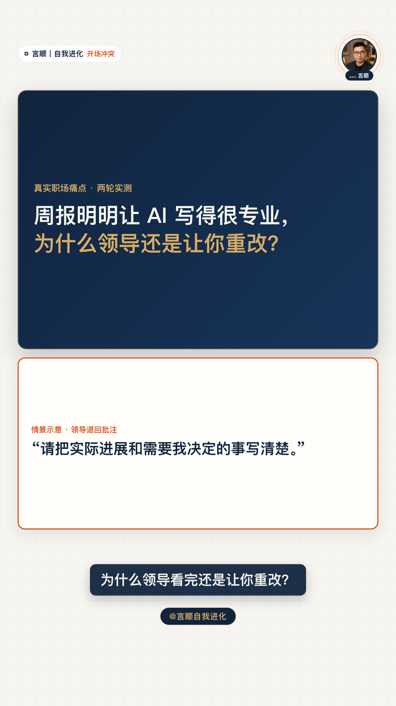
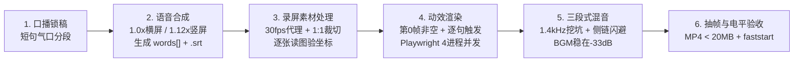

# Swiss Grid Video · 双端瑞士网格动效视频工作流（v0.3）

把方法论、AI 实测录屏或工作流复盘，通过 Agent 自动拆解并渲染成 **16:9 横屏深度版（5–7 分钟）** 与 **9:16 竖屏快节奏版（60–90 秒）** 的高清成片：**零 PPT 僵硬感 + 真人头像实时声波环 + 实况录屏推拉放大 + 三段式动态 BGM + 词级卡点字幕**。

---

## 一、成品效果预览

| 16:9 情景动画与对比布局 | 16:9 结尾「截屏带走 + 投票互动」 | 9:16 竖屏安全区与高对比卡 |
| :---: | :---: | :---: |
|  |  |  |

---

## 二、完整制作流程图与视觉安全区



### 双端安全区构图规范

```text
+---------------------------------------------------------------+ 1920x1080 (16:9)
| [品牌 · 章节胶囊]                           ( 112px 真人头像 ) |  y=24..96
| +-----------------------------------------------------------+ |
| |               主内容舞台（flex: 1 撑满纵向空间）            | |  y=98..958
| |     真实录屏推拉放大 / 情景动画卡片 / 放大镜逐项检查        | |
| +-----------------------------------------------------------+ |
|                 [ 词级同步高亮字幕胶囊 ]     [@账号名 深蓝金标] |  y=960..1060
+---------------------------------------------------------------+

+---------------------------------+ 1080x1920 (9:16 竖屏避让平台UI)
|  (避让顶部状态栏 y=0..105)       |
|  [品牌 · 章节]     (104px 头像)  |  y=105..220
|  +---------------------------+  |
|  |   主内容卡片（纵向撑满）    |  |  y=245..1430
|  |   大字标题 38-58px        |  |
|  +---------------------------+  |
|     [ 居中高亮短句字幕 ]         |  bottom=300
|         [@账号名 居中徽章]       |  bottom=220 (避让底部文案与右侧赞评)
+---------------------------------+
```

---

## 三、环境依赖（一次性安装）

```bash
# 1. Node.js 20+ & FFmpeg（macOS）
brew install node ffmpeg

# 2. Playwright Chromium（用于 16:9 / 9:16 逐帧无损渲染）
npm install playwright
npx playwright install chromium
```

---

## 四、三种配音方案配置指南（按门槛从低到高）

复制 `.env.example` 为 `.env`，`config.example.json` 为 `config.json`（均已在 `.gitignore` 中，绝不会提交到 Git）。

### 方案 A：完全免费、零 API Key（Edge TTS · 新手首选）

```bash
pip install edge-tts
```
```json
{
  "tts": {
    "engine": "edge",
    "voice": "zh-CN-YunxiNeural",
    "rate": "+12%"
  }
}
```
常用自然中文音色：`zh-CN-YunxiNeural`、`zh-CN-YunjianNeural`、`zh-CN-XiaoxiaoNeural`。

### 方案 B：本机免费离线克隆自己的声音（Apple Silicon Mac · Qwen3-TTS MLX）

完全在本地 GPU 运行，**零费用、声音样本不上云**（需准备 5–10 秒干净干声 + 对应文案）：
```bash
python3 -m venv .venv-voice && source .venv-voice/bin/activate
pip install mlx-audio soundfile numpy
```
> 提示：中英混排时给 TTS 的文本需自动去掉中英之间空格（如 `去AI味`），避免 0.6B 小模型卡顿。

### 方案 C：云端高自然度克隆（火山引擎 / 豆包语音 ICL 2.0 · 推荐日更）

1. 在火山引擎控制台开通语音合成并完成声音复刻，获取 `APP_ID`、`ACCESS_TOKEN` 与你的音色 ID。
2. 在 `.env` 中填入：
   ```dotenv
   VOLC_TTS_APP_ID=你的AppID
   VOLC_TTS_ACCESS_TOKEN=你的AccessToken
   VOLC_TTS_VOICE=你的音色ID
   VOLC_TTS_RESOURCE_ID=seed-icl-2.0
   VOLC_TTS_SPEED=0
   ```
3. **实战经验**：
   - `seed-icl-2.0` 音色相似度极高，但**不响应 `context_texts` 情绪标签**；把稿子拆成 20–40 个短句气口分段合成可显著改善呼吸节奏；
   - 若开头钩子与结尾金句需要极强真人情绪张力，推荐采用 **「首尾 15 秒手机原声实录 + 中段克隆音色讲解」** 的混合录制模式；
   - 16:9 深度版建议 `VOLC_TTS_SPEED=0`（1.0x 自然语速），9:16 竖屏短片建议 `VOLC_TTS_SPEED=12`（~1.12x 明快节奏）。

---

## 五、三段式动态 BGM 与质检清单

- **三段式 BGM 节奏**：
  1. `0:00–0:45`（钩子期）：104 BPM 微悬疑脉冲 + 低音心跳；
  2. 中段（实操拆解）：92 BPM 轻快拨弦律动，在核心反转金句前留 **3–6 秒抽空留白** + `Impact Bass` 切入下一轮；
  3. 结尾（给工具 + CTA）：76 BPM 温暖明亮钢琴和弦收束。
- **混音铁律**：BGM 在 `1.4kHz` 挖坑 `-5.0 dB` + 人声侧链闪避，说话时 BGM 均响保持在 `-33 dB` 左右，用 `ffmpeg -af volumedetect` 实测确认，绝不靠猜。
- **交付前 4 项必检**：第 0 帧非空 · 所有录屏裁切 `read_file` 对图 · `.srt` 字幕零半词截断 · MP4 `< 20MB`（`yuv420p` + `faststart`）。
