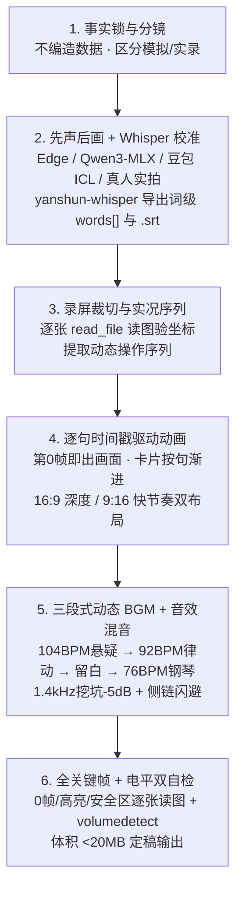

# Swiss Grid Video（16:9 + 9:16 双端瑞士网格动效视频工作流 · v0.3）

本 Skill 将方法论、AI 实测或工作流复盘，按**先声后画、真实录屏不造假、全安全区构图**的导演级标准，产出 **1920×1080（16:9，5–7 分钟深度版）** 与 **1080×1920（9:16，60–90 秒快节奏竖屏版）** 双端成片（详图与配置见 [README.md](./README.md)）。

## 端到端流程图

---

## 核心工程红线（EP01–EP02 实战沉淀）

1. **真实性红线**：严禁编造数据比例，严禁在 AI 实测录屏中伪造不存在的“AI 造假红叉”，客观区分「合理推断 ≠ 已证实动作」。
2. **第 0 帧绝不空白**：开场主卡必须在 `frame 0` 直接渲染（`opacity: 1`），禁止 `0s–0.35s` 从全空背景淡入。
3. **先配音、短句气口、再 Whisper 校准编排画面**：
   - 将长旁白拆为 **20–40 个短句气口片段**，每段之间留 `0.25s–0.65s` 呼吸停顿（16:9 用 `1.0x` 原生语速，9:16 竖屏用 `1.10x–1.15x`）。
   - **强制 Whisper 语音时间戳校准**：无论是合并后的配音轨还是真人实拍原声，成片排版前必须执行 `yanshun-whisper <音视频> -o <目录>`（本地 Apple Silicon GPU 加速 `mlx-whisper`，已过滤尾部幻觉段），直接读取生成的 `<base>.whisper.json`（`segments[]` / `words[]`）与 `<base>.whisper.srt` 驱动切场、卡片亮起、缩放推拉、拟音卡点与全片字幕，严禁估算时间轴。
   - **重要边界**：火山 `seed-icl-2.0` 克隆音色保留音色极佳，但不响应 `context_texts` 情绪提示词；若开头/结尾需要强情绪张力，建议用**真人麦克风原声实录首尾 15 秒** + 中段克隆配音。
   - 中英混排喂给 TTS 前自动去掉中英之间空格（`去AI味`），字幕仍保留规范空格（`去 AI 味`）。
4. **绝不提前堆满静态卡 & 消除上下死区**：
   - 卡片必须绑定到对应短句的时间戳才出现或亮起；
   - 主舞台使用 `flex: 1` / `justify-content: space-between` 填满安全区，**所有裁切图必须 `read_file` 读图复核坐标**，杜绝“图不对文”。
   - 左上角仅放观众可读章节名，**严禁泄露内部编号**（如 `EP02`、`M08`）。
5. **低通暖低频 BGM + 密集动效卡点（实测有效配方）**：
   - 严禁程序合成电子节拍与白噪声；选用真实器乐底轨挂载 **`lowpass=f=580, equalizer=f=110:t=q:w=1.0:g=4.0`**，削掉 `600–2500Hz` 中高频人声冲突，让 98% 背景能量沉在低频托底，停顿间隙均响保持 **`-31 dB ~ -32 dB`**（仅比人声低 `12–14 dB`），说话时轻侧链闪避（`ratio=2.2`）；
   - **密集动效拟音**：每 **6–8 秒** 必须有 1 个与画面动作对齐的真实棚拍拟音（切场 `whoosh-short`、盖章 `impact-bass`、卡片/高亮弹出 `pop`/`click-soft`、输入 `typing`），6 分钟成片约需 **40–50 个 SFX 卡点**，峰值 `alimiter=0.85` 防削波。
6. **双端安全区与交付验收**：
   - **16:9（1920×1080）**：右上角 `112px` 头像仅由人声 RMS 驱动声波环，右下角高对比深蓝暖金 `@账号名` 徽章；
   - **9:16（1080×1920）**：避让顶部系统栏（`top ≥ 110px`）与底部交互区（`bottom ≥ 220px`）；
   - 编码使用 `libx264 -pix_fmt yuv420p -ar 44100 -ac 2 -c:a aac -b:a 128k -movflags +faststart`，体积控制在 **20 MB 以内**，严禁将 `.env`、私人音色 ID 或个人照片提交至 Git。
